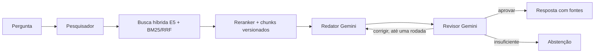

# FCTE-Campus — Avaliação do RAG Multiagente

**Grupo:** 09 — Residência em IA, FCTE/UnB
**Projeto:** [Muniz2811/FCTE-Campus](https://github.com/Muniz2811/FCTE-Campus)
**Issues:** [#1](https://github.com/Muniz2811/FCTE-Campus/issues/1), [#2](https://github.com/Muniz2811/FCTE-Campus/issues/2), [#3](https://github.com/Muniz2811/FCTE-Campus/issues/3), [#4](https://github.com/Muniz2811/FCTE-Campus/issues/4)
**Situação:** implementação preparada; **resultados ao vivo, revisão humana, validação integrada e conclusão final pendentes**.

## 1. Objetivo

Comparar (A) Gemini isolado, (B) RAG atual e (C) RAG multiagente com a mesma versão do corpus, modelo Gemini e parâmetros de geração. Medir qualidade factual, recuperação, rastreabilidade, disponibilidade, consumo e custo adicional das correções.

## 2. Arquitetura



A classe `OrquestradorMultiagente` tem orçamento padrão de até 3 buscas, 5 chamadas Gemini e 240 segundos totais. O Pesquisador planeja subconsultas; o Redator produz claims com `chunk_ids`; o backend rejeita referências inexistentes no contexto; o Revisor avalia completude e suporte semântico com decisão `aprovar`, `corrigir` ou `insuficiente`. A correção pode ocorrer **no máximo uma vez**. Todos os estados, decisões e tempos são registrados por `requestId` em `backend/data/execucoes/multiagent-*.json`.

A verificação de ID documenta a **cadeia de fonte**, mas não prova automaticamente a verdade semântica. O julgamento humano permanece obrigatório.

## 3. Controle experimental

- **Desenvolvimento/regressão:** `backend/avaliacao/gabarito.json`, 15 perguntas já usadas em ajustes. Esse conjunto **não é cego**.
- **Conferência final:** `backend/avaliacao/conferencia_final.json`, 8 perguntas de formulação nova (2 compostas, 2 de ambiguidade/contexto, 2 de premissas incorretas e 2 sem resposta). As entidades são conhecidas do corpus: portanto não constitui teste de generalização fora do domínio.
- **Paridade:** preservar a mesma `baseVersion`, Gemini configurado, temperatura, limites, data de validade documental e ambiente. O Gemini isolado não recebe documentos; os dois RAGs utilizam a mesma fonte de busca. Registrar hash do corpus, prompts e commit.
- **Ordem:** sorteio determinístico das tarefas para reduzir viés de ordem; execução sequencial para não competir pelo bloqueio de concorrência da API. Registrar tempos de serviço e tentativas.
- **Retentativa:** apenas erros técnicos elegíveis (`429, 500, 502, 503, 504`). Nunca repetir resposta semanticamente ruim para escolher uma mais favorável. Preservar todas as tentativas.
- **Histórico:** o script de comparação executa questões independentes, sem histórico interquestões. Conversas com `previousRequestId` devem ser testadas separadamente com histórico explicitamente registrado, inclusive na comparação Gemini isolado, evitando alegar igualdade quando não houver contexto equivalente.

## 4. Execução

Primeiro, instalar dependências e verificar o índice conforme o README. Em PowerShell na raiz:

```powershell
npm.cmd ci
npm.cmd run rag:check
.\backend\.venv\Scripts\python.exe -m pytest backend/tests/test_multiagente.py -q
npm.cmd run build
```

Em seguida, com `backend/.env` preenchido localmente e sem registrar credenciais no repositório:

```powershell
.\backend\.venv\Scripts\python.exe backend/scripts/comparar_tres_modos.py --env-file backend/.env --conjunto desenvolvimento
.\backend\.venv\Scripts\python.exe backend/scripts/comparar_tres_modos.py --env-file backend/.env --conjunto conferencia
```

O script imprime a pasta correspondente à rodada, que conterá `execucoes.json` e `gabarito.json`. Não executar a conferência final até que prompts e código estejam congelados.

Gerar a ficha de julgamentos com o caminho **real** da pasta criada:

```powershell
.\backend\.venv\Scripts\python.exe backend/scripts/resumir_tres_modos.py backend/avaliacao/resultados/PASTA_DA_RODADA --preparar
```

Preencher todos os campos aplicáveis em `julgamentos.json`, com revisor, observação e fontes originais consultadas. Comparar cada afirmação atômica com seu chunk citado e o original. Então executar:

```powershell
.\backend\.venv\Scripts\python.exe backend/scripts/resumir_tres_modos.py backend/avaliacao/resultados/PASTA_DA_RODADA
```

O resultado `metricas.json` apresenta numeradores e denominadores. Dados sem revisão continuam N/A, não zero.

## 5. Métricas e denominadores

| Indicador | Numerador | Denominador |
|---|---|---|
| Completude | Perguntas respondíveis integralmente atendidas | Perguntas respondíveis com revisão identificada |
| Corroboração | Afirmações factuais corroboradas | Afirmações factuais julgadas |
| Correção de premissas | Perguntas com premissa explicitamente corrigida | Perguntas com premissa falsa julgadas |
| Reconhecimento de ausência | Abstenções corretas | Perguntas sem resposta julgadas |
| Hit@5 | Respondíveis com pelo menos um trecho relevante entre os cinco | Respondíveis com busca revisada |
| Precisão dos trechos | Todos os trechos relevantes recuperados | Todos os trechos recuperados nos casos julgados, **incluindo perguntas sem resposta** |
| MRR@5 | Soma do inverso do rank do primeiro trecho relevante | Respondíveis com busca revisada |
| Fundamentação | Fatos sustentados pelos chunks citados | Fatos julgados nas respostas com RAG |
| Rastreabilidade | Vínculos claim-chunk resolvidos até o original | Vínculos claim-chunk verificados |
| Adequação das citações | Vínculos cujo chunk realmente sustenta a claim | Vínculos claim-chunk julgados |
| Disponibilidade | Chamadas HTTP 200 | Todas as tentativas, inclusive falhas técnicas |
| Sucesso inicial | Perguntas HTTP 200 na primeira tentativa | Perguntas iniciadas |

A latência válida considera somente respostas HTTP 200; o esforço operacional soma **todas** as tentativas observadas. O consumo por agente é registrado a partir de `usageMetadata`, quando disponível, e não deve ser presumido se ausente.

No multiagente, computar separadamente as revisões `melhorou`, `piorou`, `neutra` e `sem_correcao` após comparar o primeiro rascunho com a versão final, usando as mesmas fontes.

## 6. Baseline já existente (12/11/2026)

A rodada anterior [`semana3-llm-rag-20261112-v1`](https://github.com/Muniz2811/FCTE-Campus/tree/main/backend/avaliacao/resultados/semana3-llm-rag-20261112-v1) comparou **somente Gemini isolado e RAG atual**:

| Medida | Gemini isolado | RAG atual |
|---|---:|---:|
| Completude | 4/12 | 12/12 |
| Correção de premissas | 1/2 | 2/2 |
| Ausência reconhecida | 3/3 | 3/3 |
| Latência média válida | 6,93 s | 11,40 s |
| Sucesso na primeira tentativa | 12/15 | 9/15 |
| Precisão de trechos | N/A | 16/58 |

Esses resultados **não medem** o multiagente e **não são comparáveis diretamente** com uma nova rodada cuja base ou configuração tenha sido alterada.

## 7. Resultados da nova rodada

**PENDENTE DE EXECUÇÃO**. Inserir aqui a tabela extraída de `metricas.json` dos três modos. Não publicar números artificiais. Documentar casos concretos com pergunta, resposta, trecho, erro ou acerto, revisor responsável e link para os artefatos.

### Análise das correções

**PENDENTE DE REVISÃO HUMANA**. Registrar, para cada execução corrigida, o texto anterior, o feedback, o texto final e se a correção melhorou ou prejudicou o resultado. As decisões do Revisor por si só não são evidência de melhoria.

## 8. Limitações

- 15 perguntas de regressão conhecidas e 8 de conferência com sobreposição de temas; amostra pequena.
- Verificação semântica exige humano; o revisor automático pode aprovar uma afirmação incorreta.
- Chamadas Gemini podem sofrer cota, timeout e variações do provedor.
- Tokens ausentes não podem ser inferidos como zero consumo.
- Testes de carga, usuário real, histórico interturnos e deploy público não são cobertos pelo experimento padronizado.
- O uso de vários agentes consome mais chamadas; benefício precisa superar os custos e o tempo adicional.

## 9. Conclusão

**PENDENTE.** Selecionar, após a revisão da conferência, o fluxo que melhor equilibra completude, corroboração factual, disponibilidade, latência, tokens, rastreabilidade e correção de premissas. A comparação anterior favoreceu o RAG atual frente ao Gemini isolado, mas não demonstra superioridade do multiagente.

## 10. Referências

- Es et al. (2024), [RAGAs: Automated Evaluation of Retrieval Augmented Generation](https://aclanthology.org/2024.eacl-demo.16/).
- Manning et al., [Evaluation of ranked retrieval results](https://nlp.stanford.edu/IR-book/html/htmledition/evaluation-of-ranked-retrieval-results-1.html).
- [Sentence Transformers — Retrieve & Re-Rank](https://www.sbert.net/examples/sentence_transformer/applications/retrieve_rerank/README.html).
- [Repositório e issues FCTE-Campus](https://github.com/Muniz2811/FCTE-Campus/issues).
