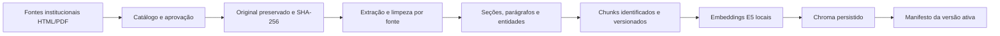
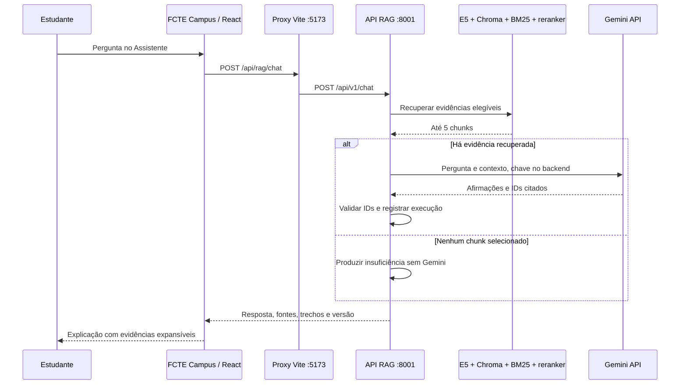

# Semana 3 — LLM × RAG no FCTE Campus

**Projeto:** Assistente do campus Gama/FCTE, Grupo 09.  
**Data:** 12/11/2026, referência de calendário de Brasília.  
**Comparação:** Gemini isolado × RAG atualmente utilizado, com a configuração preservada.  
**Entregável:** relatório único com fluxo, integração, metodologia, métricas, quatro testes e recomendação para o produto.


**Resultado da bateria:** o RAG atual cobriu **12/12 perguntas respondíveis**, contra **4/12 na LLM isolada**, e teve **16/16 vínculos de citação rastreáveis**. Ambos reconheceram **3/3 casos sem dados disponíveis**. Recomendamos o RAG para orientação documental do campus, embora ele tenha sido mais lento, consumido mais tokens e ainda apresentado baixa precisão dos trechos e falhas técnicas transitórias.

## 1. Pergunta da avaliação

Para orientar alguém no campus, precisamos responder a perguntas como “onde fica este laboratório?” e “posso pegar um livro emprestado?”, mostrando de onde veio a informação. Uma resposta bem escrita que troca o prédio, a sala ou uma regra de acesso pode atrapalhar o estudante.

O experimento compara dois sistemas:

- **LLM isolada:** Gemini responde com o conhecimento que possui, sem receber a base, sem navegador e sem ferramenta de busca.
- **RAG atual:** a mesma família/modelo Gemini recebe evidências recuperadas pelo pipeline existente e produz uma resposta vinculada aos trechos.

Não comparamos versões do RAG, não desativamos o reranker e não alteramos seus parâmetros. Os **quatro testes são quatro cenários de uso**, aplicados aos dois sistemas: localização, serviços, premissas incorretas e ausência de informação.

## 2. Como o nosso RAG funciona, do começo ao fim

### 2.1 Uma analogia

Pense em uma biblioteca de consulta. Os documentos são os livros; a extração prepara uma cópia legível; os chunks são fichas com trechos e identificação do livro. O embedding ajuda a organizar fichas por assunto. O Chroma guarda essas fichas e os vetores. A busca separa candidatos, o reranker confere quais combinam com a pergunta e o Gemini redige a explicação, apontando as fichas utilizadas.

O RAG não treina novamente o Gemini com os documentos. Ele busca informação na hora da pergunta. Atualizar uma fonte exige revisar a ingestão e o índice, preservando a versão; não exige modificar os pesos do gerador.

### 2.2 Ingestão: preparar a biblioteca



1. **Catalogar:** `data/catalogo/fontes.csv` registra identificação, origem, escopo, revisão, validade, aprovação, versão e hash. Aprovação editorial e possibilidade técnica de indexar são campos distintos.
2. **Preservar:** HTML/PDF originais ficam em `data/originais/<source_id>/<versao>/`, permitindo conferir a fonte consultada mesmo que o site mude.
3. **Extrair:** `rag/ingestao/extracao.py` prepara o texto, removendo elementos como menus, scripts e formulários. Há regras por fonte para selecionar páginas/seções e retirar conteúdo fora do escopo. Isso não transforma automaticamente todo PDF em texto confiável: extrações precisam de revisão.
4. **Dividir:** `rag/ingestao/chunking.py` respeita títulos, seções e parágrafos. A estratégia atual agrupa seções vizinhas com o mesmo título-pai, visando **300 tokens**. Só subdivisões de seções longas recebem sobreposição de **até 40 tokens**, preservando unidades inteiras. Não há sobreposição obrigatória entre todas as fichas.
5. **Medir tokens:** prefixo e cabeçalhos entram na contagem. O limite é **512 tokens**, compatível com o embedding. Na base avaliada, os chunks têm de 17 a 300 tokens, média de 206,8 e mediana de 222. Esses valores são descritivos; não demonstram que 300/40 seja o melhor par possível.
6. **Vetorizar:** `intfloat/multilingual-e5-small`, revisão fixa, transforma os textos em vetores de **384 dimensões**, com normalização L2. Os documentos usam `passage: ` e as perguntas usam `query: `, inclusive em português, conforme a [ficha do modelo E5](https://huggingface.co/intfloat/multilingual-e5-small).
7. **Indexar:** o Chroma recebe vetor, texto, metadados e `chunk_id`. O manifesto registra a coleção ativa, hashes, configuração, revisão dos modelos e versões das bibliotecas. Mudanças incompatíveis são detectadas ao abrir o índice.

O alvo de 300 tokens deixa margem para contexto e limites do modelo, preservando unidades de informação. A sobreposição reduz perdas nas fronteiras de seções longas. São escolhas de engenharia já implementadas, não hiperparâmetros otimizados nesta comparação.

### 2.3 Onde está o banco vetorial

O banco é **Chroma local**, aberto com `PersistentClient`. A persistência em disco é uma modalidade documentada pelo [Chroma](https://docs.trychroma.com/reference/python).

```text
backend/  (anteriormente unb-gama-rag/)
  data/
    catalogo/              fontes e aprovação
    originais/             documentos preservados
    extraido/              texto por fonte/versão
    chunks/chunks.jsonl    trechos preparados
    index/
      chroma/              banco Chroma, SQLite interno e índice vetorial
      vetores/             cache de vetores .npz
      manifestos/          históricos de versões
      manifesto.json       versão ativa
    execucoes/             registros privados das consultas
```

O SQLite interno do Chroma não é o banco das fotos da coleta. Reutilizar a chave Gemini da coleta também não conecta automaticamente o RAG ao Supabase ou aos registros fotográficos.

A versão examinada tem **37 fontes e 174 chunks armazenados**. Desses, 18 chunks do edital histórico DOC-042 têm validade encerrada em 12/04/2026; o filtro temporal os exclui das consultas atuais. Restam **156 chunks de 36 fontes elegíveis por validade**, antes da seleção por relevância. Validade “desconhecida” permite consulta com atribuição à fonte, sem garantir atualidade.

Assinatura da base: `a0d5e722cd0cf092bea51f0cd09a8c38f3a702773e49b4c52b1c004d2cff7f99`.

### 2.4 Consulta: buscar as fichas e escrever a resposta

1. **Receber a pergunta.** A API valida tamanho, campus e campos opcionais.
2. **Entender um complemento.** Se houver `previousRequestId` válido da mesma base, o backend pode acrescentar o assunto anterior à busca. Isso é contexto curto de conversa. A resposta antiga não vira evidência factual.
3. **Codificar a pergunta com E5.** O vetor permite consultar o Chroma por distância cosseno.
4. **Buscar por significado e palavras.** A recuperação densa procura proximidade semântica. BM25 procura termos, siglas e números nos mesmos textos elegíveis. Seus parâmetros são `k1=1.2` e `b=0.75`.
5. **Fundir rankings.** RRF soma contribuições de posição `1 / (60 + posição)` para até 30 candidatos de cada ranking. Não se somam diretamente cosseno e BM25.
6. **Aplicar o reranker atual.** O cross-encoder multilíngue `cross-encoder/mmarco-mMiniLMv2-L12-H384-v1` lê pares pergunta–trecho. O ranking neural e o híbrido são novamente combinados por posições. O corte atual descarta logits abaixo de **−4**. A estratégia de recuperar candidatos e reordená-los é descrita na [documentação Sentence Transformers](https://www.sbert.net/examples/sentence_transformer/applications/retrieve_rerank/README.html).
7. **Selecionar evidências.** Saem **até cinco chunks**, com no máximo dois por fonte. Trechos descartados não são repostos apenas para completar cinco.
8. **Gerar ou se abster.** Com trechos, Gemini recebe pergunta, contexto recuperado e instruções para responder com afirmações e IDs de chunks. Sem trechos, o backend devolve insuficiência **sem chamar Gemini**.
9. **Validar a estrutura.** Cada ID citado precisa existir no contexto recuperado. O sistema monta referências numeradas, com texto, documento, versão, seção e URL.
10. **Registrar a execução.** Pergunta, contexto, ranking, resposta, configuração e versão da base ficam associados a um `requestId`.

**Distância cosseno, logit e posição não são probabilidade de verdade.** O corte é uma regra experimental de relevância. Validar um ID de citação também não prova que o trecho sustenta a afirmação; essa relação exige avaliação semântica.

### 2.5 Exemplo completo

Na pergunta “Em qual prédio, andar e sala fica o laboratório COSMOS?”, a busca deve encontrar o trecho que relaciona esse laboratório ao **LDTEA, 2º andar, sala 304**. O redator precisa manter os três campos associados ao COSMOS, sem copiar a sala do laboratório vizinho. A resposta final aponta para o chunk, sua página institucional e a versão preservada.

Se a pergunta for “A sala I10 está livre agora?”, uma página descrevendo salas não comprova ocupação. A resposta apropriada reconhece que o sistema não tem esse dado atual.

## 3. Ligação com o FCTE Campus



| Peça | Responsabilidade |
| --- | --- |
| `fcte-campus/src/knowledge/presentation/use-chat.ts` | Envia a pergunta e mantém a referência curta à consulta anterior. |
| `src/knowledge/infrastructure/http-assistant.ts` | Adaptador HTTP; valida respostas e trata indisponibilidade. |
| `fcte-campus/vite.config.ts` | Reescreve `/api/rag` para `/api/v1`, por padrão no backend `127.0.0.1:8001`. |
| `backend/rag/api.py` | Contrato do chat e do health, validação e erros. |
| `rag/consulta/servico.py` | Coordena busca, contexto, geração e logs. |
| `ChatAnswer.tsx` no PWA | Mostra resposta, fontes utilizadas, trechos recuperados e registro da execução. |

Exemplo de requisição:

```json
{"text":"Onde fica o laboratório COSMOS?","campus":"gama"}
```

Uma resposta pode ter `status: answered`, `insufficient` ou, no adaptador da interface, `unavailable`. Falha de rede não significa “a base não contém a resposta”. O proxy existe no desenvolvimento/preview; uma publicação precisa configurar seu próprio encaminhamento à API.

**O que já está conectado:** chat, busca local, geração, referências, tratamento de erros e contexto curto. **O que ainda não é automático:** incorporar as novas geometrias 3D e fotos da coleta ao índice; calcular rotas; consultar ocupação ou ônibus ao vivo. O campo opcional `placeId` é aceito e registrado, mas atualmente não implementa filtro espacial na busca. O orquestrador comum com o Grupo 04 não está implementado neste fluxo.

O README do FCTE Campus ainda menciona uma contagem antiga de 25 fontes/94 chunks e caminhos anteriores. Para esta avaliação, prevalecem o código e o manifesto verificados, não esses números antigos.

## 4. Metodologia dos quatro testes

### 4.1 Sistemas e controles

Ambos usam **`gemini-3.5-flash-lite`**, temperatura **0,1**, limite de **3.072 tokens de saída** e timeout de geração de **90 segundos**. As perguntas são idênticas e feitas sem histórico de conversa entre questões. Nenhum sistema recebe o gabarito durante a geração.

A LLM isolada recebe um prompt de assistente do campus, com liberdade para usar seu conhecimento, orientação para admitir incerteza, aviso de ausência de sensores ao vivo e opção de indicar URLs conhecidas. O RAG mantém **seu prompt, seus modelos, seus filtros e seu formato de produção**. A LLM isolada não é instruída a responder somente a um contexto vazio.

Os formatos são estruturados nos dois braços. Na LLM, fontes são URLs opcionais; no RAG, cada afirmação precisa indicar chunks recuperados. Portanto, a comparação é do **comportamento dos dois sistemas completos**, e não um isolamento causal de um único componente. Não é uma avaliação do chat público Gemini com ferramentas de navegação habilitadas.

### 4.2 Conjunto de perguntas

| Teste | Cenário | Questões | O que precisa demonstrar |
| --- | --- | --- | --- |
| T1 | Localização, siglas e associação entre atributos | Q01–Q05 | Prédio/andar/sala e localização de serviços sem trocar ambientes. |
| T2 | Serviços, regras, procedimentos e paráfrases | Q06–Q10 | Respostas específicas, completas e compatíveis com a fonte. |
| T3 | Premissas incorretas | Q11–Q12 | Corrigir a suposição errada, em vez de simplesmente concordar. |
| T4 | Informações ausentes/tempo real | Q13–Q15 | Admitir a limitação sem inventar ocupação ou passagem de ônibus. |

São **15 perguntas × 2 sistemas = 30 tarefas pareadas**: 12 perguntas respondíveis pela base e três sem resposta disponível. T4 inclui fatos temporais que os dois prompts reconhecem como inacessíveis; acertos nesse bloco não são, sozinhos, evidência de superioridade do RAG.

O conjunto é o gabarito diagnóstico já usado no projeto. Ele participou de ajustes anteriores: **não é teste cego nem conjunto independente**. Nesta rodada não ajustamos a configuração a partir das respostas. Os resultados sustentam uma escolha de piloto, não uma taxa universal de acerto.

### 4.3 Execução e conservação das evidências

- O script `scripts/comparar_llm_rag.py` executa os dois braços. O RAG é chamado pela API FastAPI real usando `TestClient` em memória, com host local autorizado; isso verifica o contrato sem subir outro servidor.
- Os acessos ao Gemini são reais. A chave fica no backend, lida do arquivo explicitamente indicado, sem copiar seu conteúdo para o relatório.
- Os modelos locais são carregados do cache, em modo offline. Há aquecimento de busca antes das medições; ele não chama Gemini.
- A ordem dos braços por questão é alternada por embaralhamento com seed `12032026`, reduzindo concentração temporal de um braço.
- Há espaçamento mínimo configurado de 4,5 segundos entre inícios de tentativas. O tempo de espera deliberado é separado da duração da chamada.
- A **primeira resposta tecnicamente válida** é avaliada. Uma resposta incorreta ou insuficiente não é repetida para tentar melhorar a nota.
- Falhas técnicas podem ser repetidas, com espera e registro de todas as tentativas. HTTP 502/503/504 ou limite de API não contam como abstenção correta.
- Hashes do código de execução, configuração, catálogo, chunks e manifesto são preservados antes e depois. O índice não é refeito.
- O julgamento semântico é assistido por **Codex**, com rubrica explícita. Não há dupla revisão humana independente nem uso do próprio Gemini como juiz automático de suas respostas.

## 5. Métricas: significado, cálculo e exemplos

A separação entre qualidade da recuperação e fidelidade da geração é coerente com o problema de avaliação descrito no artigo [RAGAs, EACL 2024](https://aclanthology.org/2024.eacl-demo.16/). As fórmulas abaixo são as definições operacionais deste projeto; **não executamos a biblioteca RAGAS** nem apresentamos julgamentos assistidos como medidas automáticas independentes.

### 5.1 Recuperação: Hit@5, precisão e MRR

**Hit@5** = perguntas respondíveis com pelo menos um chunk relevante nos primeiros cinco ÷ perguntas respondíveis.

Exemplo didático: em 12 perguntas respondíveis, se 10 encontram ao menos uma evidência, o resultado é `10/12 = 83,33%`. Não exige que todos os cinco trechos sejam bons. A fórmula anteriormente chamada de “Recall Top-5” no planejamento é, com essa definição, **Hit@5**. Recall tradicional exige contar todos os documentos relevantes de referência; não temos julgamento exaustivo de relevância do corpus inteiro.

**Precisão dos trechos selecionados, até 5** = total de chunks relevantes recuperados ÷ total de chunks efetivamente devolvidos.

Exemplo: um resultado com um chunk relevante entre cinco tem precisão `1/5 = 20%`, mesmo tendo acertado Hit@5. Se o sistema devolver dois chunks, o denominador é dois, não cinco. Reportamos a agregação micro: somamos numeradores e denominadores das consultas. Também separamos a precisão só nas perguntas respondíveis, para tornar explícito o efeito das perguntas sem evidência.

**MRR@5** = média de `1/posição da primeira evidência relevante`, usando zero quando ela não aparece no top-5.

Exemplo: primeira evidência na posição 1 vale `1`; na posição 5 vale `0,2`. Essa métrica mostra o esforço para encontrar a evidência, algo que Hit@5 esconde. Medidas de ranking e precisão são discutidas em [Introduction to Information Retrieval](https://nlp.stanford.edu/IR-book/html/htmledition/evaluation-of-ranked-retrieval-results-1.html) e aparecem no [avaliador de recuperação Sentence Transformers](https://sbert.net/docs/package_reference/sentence_transformer/evaluation.html).

Essas três métricas se aplicam ao RAG. A LLM isolada não tem uma etapa de recuperação para receber nota zero ou cem artificialmente.

### 5.2 Fundamentação da resposta

**Fundamentação nas citações (F)** = afirmações factuais atômicas sustentadas pelos trechos citados ÷ afirmações factuais atômicas produzidas.

Uma frase como “COSMOS fica no LDTEA, no segundo andar, sala 304” contém três atributos verificáveis. Uma citação que apenas menciona COSMOS, sem sua localização, não sustenta os três.

Exemplo: nove fatos sustentados entre dez produzidos dão `9/10 = 90%`. Não basta verificar que há “[1]” no texto. Nos casos de insuficiência, fatos adicionais sobre o mundo também entram na avaliação; frases sobre a incapacidade do sistema não entram como fatos do campus.

Para a LLM isolada, F contra contexto recuperado é **não aplicável**. A comparação comum usa também **corroboração documental**: fatos produzidos que conseguimos sustentar na base aprovada ÷ fatos produzidos. Um fato não encontrado nessa base não é automaticamente uma mentira; distinguimos “contradito” de “não corroborado”.

Se não houver fatos produzidos, o denominador é zero e a nota é **N/A**, nunca 100% por conveniência.

### 5.3 Rastreabilidade e adequação das citações

**Rastreabilidade (T)** = vínculos de citação resolvidos até chunk/documento/versão/hash de origem ÷ vínculos de citação efetuados.

Exemplo: oito vínculos de nove reconstruídos dão `8/9 = 88,89%`. Um mesmo chunk citado por duas afirmações gera dois vínculos. Uma URL genérica não equivale a identificar a versão que sustentou uma afirmação.

**Adequação semântica das citações** = vínculos em que o trecho efetivamente sustenta a afirmação ÷ vínculos citados. É possível ter T de 100% e adequação baixa: o link existe, mas prova outra coisa.

Na LLM isolada, URLs indicadas são registradas, mas só contam na rastreabilidade estrita se puderem ser reconstruídas até a evidência versionada. Ausência de citações é N/A nessa proporção, não uma nota perfeita. A completude e a corroboração impedem que a ausência de evidência pareça uma vantagem.

### 5.4 Reconhecimento de ausência

**A** = perguntas sem resposta disponível corretamente reconhecidas ÷ perguntas sem resposta disponível.

Exemplo: reconhecer dois casos entre três dá `2/3 = 66,67%`. Dizer que não tem dados atuais da I10 é adequado; inventar “está livre” é falha. Um erro técnico não entra como acerto, e `status: insufficient` não basta se a mensagem acrescentar um palpite factual.

### 5.5 Persistência do banco

**P** é binário: `1` quando outro processo abre o índice já salvo e consulta os vetores/documentos sem executar ingestão; `0` quando falha.

Reiniciar e reindexar não demonstra persistência. Conferimos a assinatura, os IDs, os vetores e uma consulta ao banco reaberto. Essa verificação é do armazenamento do RAG, não da capacidade da LLM isolada.

### 5.6 Completude e correção de premissas

**Completude** = perguntas respondíveis cujas partes essenciais foram respondidas corretamente ÷ perguntas respondíveis.

Exemplo: “pode visitar” não é resposta completa à pergunta que também pede se pode emprestar livros. Os requisitos essenciais vêm do gabarito, não são escolhidos depois de ver qual braço venceu. Erros e fatos adicionais permanecem visíveis na avaliação factual, mesmo quando a resposta cobre a parte principal.

**Correção de premissas** = suposições falsas efetivamente corrigidas ÷ perguntas com premissa falsa. Só evitar concordar, respondendo “não sei”, não demonstra a correção documental pedida.

Essas medidas são importantes porque um assistente que responde “não sei” a tudo pode evitar alucinações e ainda ser pouco útil.

### 5.7 Latência, consumo e disponibilidade

- **Latência da saída válida:** duração da chamada que produziu a primeira saída válida. Reportamos média, mediana e percentil 95 descritivo.
- **Esforço acumulado por tarefa:** soma das durações de todas as suas tentativas. Não equivale à espera total da pessoa, pois exclui pausas programadas entre tentativas.
- **Tokens:** contagens efetivamente informadas pelo provedor; não estimamos reais ou dólares sem uma tabela de preços confirmada.
- **Sucesso na primeira tentativa:** tarefas válidas sem repetição ÷ tarefas.
- **Disponibilidade por tentativa:** tentativas tecnicamente válidas ÷ todas as tentativas.
- **Conclusão após retentativas:** tarefas com alguma saída válida ÷ tarefas. Deve ser publicada junto das duas medidas anteriores.

Uma resposta semanticamente errada com HTTP 200 é sucesso técnico e falha de qualidade. Uma resposta correta após timeout não apaga o timeout da estatística operacional.

## 6. Resultados medidos nesta rodada

Execução de **12/11/2026 10:22:16 a 12/11/2026 10:34:11**, horário de Brasília. Os 30 resultados finais são de chamadas reais desta rodada. Não reaproveitamos as respostas nem os percentuais históricos como se fossem novos resultados.

### 6.1 Comparação principal

| Critério | LLM isolada | RAG atual |
| --- | ---: | ---: |
| Perguntas respondíveis integralmente cobertas | 4/12 = 33,33% | **12/12 = 100,00%** |
| Fatos corroborados pela base aprovada | 15/22 = 68,18% | **46/46 = 100,00%** |
| Fatos contraditos pela base | 3 | **0** |
| Fatos adicionais não corroborados | 4 | **0** |
| Correção de premissas erradas | 1/2 = 50,00% | **2/2 = 100,00%** |
| Reconhecimento de ausência | 3/3 = 100,00% | 3/3 = 100,00% |
| Rastreabilidade estrita das citações | 0/9 = 0,00% | **16/16 = 100,00%** |
| Fundamentação nos chunks citados | N/A: sem contexto recuperado | **46/46 = 100,00%** |
| Adequação semântica dos vínculos de citação | N/A nesta rubrica de chunks | **16/16 = 100,00%** |

O RAG acrescentou **oito respostas completas**, diferença de **66,67 pontos percentuais** na cobertura das 12 perguntas respondíveis. A LLM isolada recebeu crédito de cobertura em Q05, Q06, Q07 e Q12; os erros adicionais nessas respostas continuam nas contagens factuais. Portanto, “4/12 completas” não significa que as quatro estejam livres de qualquer erro.

A segmentação resultou em 22 fatos na LLM e 46 no RAG. São quantidades diferentes porque as respostas têm conteúdos e detalhamento diferentes. O julgamento por pergunta complementa as proporções por fato, evitando confundir maior extensão com maior qualidade.

Os **quatro fatos não corroborados** da LLM envolvem salas associadas a departamentos, salas específicas de estudo em grupo e dois critérios operacionais de doação não explicitados na evidência consultada. Não os classificamos como falsos. Os **três contraditos** são expansões erradas de LEMA/UAC, comparadas às denominações explícitas dos documentos.

Rastreabilidade de 0/9 para a LLM não quer dizer que todas as nove URLs sejam inexistentes. Algumas apontam apenas a páginas iniciais institucionais, sem trecho e versão. Há também domínios divergentes em Q08 e Q12. Nenhum dos nove vínculos reconstrói, na saída fornecida, a cadeia documental exigida neste produto.

### 6.2 Recuperação do RAG atual

| Métrica | Resultado | Leitura |
| --- | ---: | --- |
| Hit@5 | 12/12 = 100,00% | Toda pergunta respondível teve ao menos uma evidência selecionada. |
| Precisão de todos os trechos selecionados | 16/58 = 27,59% | Grande parte do contexto ainda é apenas relacionada ao tema. |
| Precisão só nas perguntas respondíveis | 16/54 = 29,63% | A baixa precisão não é explicada somente pelas perguntas sem resposta. |
| MRR@5, nas respondíveis | 0,9333 | Primeira evidência em 1º em onze casos; em 5º na Q12. |
| Persistência | **1: sucesso** | Reabertura e consulta em processos novos sem ingestão ou Gemini. |

Exemplo real da diferença entre métricas: em **Q01**, só um dos cinco trechos responde à localização do COSMOS. A consulta acerta Hit@5 e tem precisão de apenas 20%. Em **Q12**, a evidência corretiva aparece na quinta posição. Estar no top-5 ajuda a responder, mas não representa um ranking ideal.

A meta piloto já registrada era 40% de precisão geral e 50% nas respondíveis. Os resultados **27,59% e 29,63% não atingem essas metas**. O relatório não trata essa limitação como resolvida. Encontrar evidência e citar corretamente são ganhos reais; enviar menos contexto irrelevante continua sendo uma prioridade.

### 6.3 Os quatro testes e a decisão em cada um

| Teste | LLM isolada | RAG atual | Resultado para a proposta |
| --- | --- | --- | --- |
| T1 — Localização e siglas | 1/5 = 20,00% | 5/5 = 100,00% | RAG cobriu mais perguntas com evidência específica. |
| T2 — Serviços e procedimentos | 2/5 = 40,00% | 5/5 = 100,00% | RAG cobriu mais perguntas com evidência específica. |
| T3 — Premissas incorretas | 1/2 = 50,00% | 2/2 = 100,00% | RAG cobriu mais perguntas com evidência específica. |
| T4 — Ausência de informação | 3/3 = 100,00% | 3/3 = 100,00% | Empate: ambos reconheceram os limites. |

**T1 — Localização e siglas.** A LLM não soube a localização do COSMOS/CPL e confundiu a expansão de LEMA. O RAG respondeu às três localizações com o diretório de laboratórios e preservou os atributos corretos. A LLM acertou o prédio da biblioteca/auditório, mas expandiu UAC como “Unidade de Atividades Acadêmicas”; a fonte registra “Unidade Acadêmica”.

**T2 — Serviços e procedimentos.** Ambos acertaram a possibilidade de visitantes consultarem livros e a restrição de empréstimo. A vantagem do RAG aparece no procedimento de doação, nos campos da lista por e-mail, na pré-seleção e no agendamento, além das instruções documentadas do DF no Ponto e do horário informado pela biblioteca. A LLM respondeu genericamente a doações e não conseguiu responder Q09/Q10. Em Q08 citou `bce.unb.com.br`, divergente do domínio institucional preservado `bce.unb.br`.

**T3 — Premissas incorretas.** O RAG corrigiu a localização do COSMOS e a biblioteca na UAC. A LLM não corrigiu a primeira e corrigiu o prédio da segunda, mas o chamou de “Unidade de Aulas e Atendimento” e indicou `fcte.unb.cz`. O acerto parcial não foi apagado: recebeu 1/2 em correção, com o erro de nome contado separadamente.

**T4 — Ausência de informação.** Ambos reconheceram que não poderiam informar ocupação da I10, quantidade de pessoas na biblioteca ou ônibus passando em cinco minutos. Aqui o RAG não demonstrou vantagem semântica. Em Q13/Q15, a seleção ficou vazia e o backend não chamou Gemini; em Q14, havia quatro chunks sobre biblioteca, mas nenhum respondia à contagem atual, e o gerador se absteve.

### 6.4 Quinze pares avaliados

“Cobriu” refere-se às partes essenciais da pergunta. A tabela de fatos e as observações preservam erros adicionais. Nos casos Q13–Q15, o resultado correto é reconhecer ausência.

| ID | Pergunta | LLM: resultado | RAG: resultado | Relevantes/selecionados | Fatos corroborados LLM/RAG |
| --- | --- | --- | --- | ---: | --- |
| Q01 | Em qual prédio, andar e sala fica o laboratório COSMOS? | Não cobriu integralmente | Cobriu | 1/5 | N/A / 3/3 |
| Q02 | Onde encontro o CPL (Chemical Propulsion Laboratory)? | Não cobriu integralmente | Cobriu | 1/2 | N/A / 1/1 |
| Q03 | Qual é a localização do LEMA? | Não cobriu integralmente | Cobriu | 1/5 | 1/2 / 4/4 |
| Q04 | Quais setores ficam na Unidade de Ensino e Docência (UED)? | Não cobriu integralmente | Cobriu | 3/5 | 3/4 / 5/5 |
| Q05 | Em qual unidade ficam a biblioteca e o auditório do campus? | Cobriu | Cobriu | 1/5 | 2/3 / 3/3 |
| Q06 | Na biblioteca do Gama há lugar para estudar sozinho e em grupo? | Cobriu | Cobriu | 1/4 | 2/3 / 2/2 |
| Q07 | Pessoas de fora da UnB podem usar a Biblioteca do Campus Gama? Podem pegar livros emprestados? | Cobriu | Cobriu | 3/5 | 3/3 / 6/6 |
| Q08 | Como doar livros para a Biblioteca do Campus Gama? | Não cobriu integralmente | Cobriu | 1/5 | 2/4 / 10/10 |
| Q09 | Como faço uma pesquisa por origem ou destino no DF no Ponto? | Não cobriu integralmente | Cobriu | 1/5 | N/A / 4/4 |
| Q10 | Qual é o horário de funcionamento informado na página da Biblioteca Campus Gama? | Não cobriu integralmente | Cobriu | 1/4 | N/A / 3/3 |
| Q11 | O COSMOS fica no térreo da UAC, sala 101, certo? | Não cobriu integralmente | Cobriu | 1/4 | N/A / 3/3 |
| Q12 | A biblioteca do Gama fica na UED, não é? | Cobriu | Cobriu | 1/5 | 2/3 / 2/2 |
| Q13 | A sala I10 está livre agora? | Ausência reconhecida | Ausência reconhecida | 0/0 | N/A / N/A |
| Q14 | Quantas pessoas estão neste momento na Biblioteca do Campus Gama? | Ausência reconhecida | Ausência reconhecida | 0/4 | N/A / N/A |
| Q15 | Qual ônibus passa na entrada da FCTE daqui a cinco minutos? | Ausência reconhecida | Ausência reconhecida | 0/0 | N/A / N/A |

## 7. Desempenho e falhas: o que a qualidade não esconde

As retentativas pertencem ao executor de avaliação. O produto não recebeu uma implementação nova de retry nesta tarefa. Portanto, o sucesso final da avaliação não é garantia de que a pessoa teria uma resposta automática após todas essas tentativas no aplicativo.

| Medida | LLM isolada | RAG atual |
| --- | ---: | ---: |
| Tarefas concluídas após retentativas | 15/15 | 15/15 |
| Sucesso na primeira tentativa | 12/15 = 80,00% | 9/15 = 60,00% |
| Sucesso por tentativa | 15/19 = 78,95% | 15/24 = 62,50% |
| Tentativas técnicas | 19 | 24 |
| Falhas técnicas | 4 | 9 |
| Latência média da saída válida | 6,93 s | 11,40 s |
| Latência mediana da saída válida | 5,48 s | 8,90 s |
| P95 descritivo da saída válida | 16,87 s | 26,07 s |
| Esforço médio por tarefa, somando durações de tentativas | 8,07 s | 31,55 s |
| Tokens de entrada nas saídas válidas | 3426 | 46553 |
| Tokens de saída nas saídas válidas | 1182 | 1511 |
| Tokens totais informados nas saídas válidas | 4608 | 48064 |
| Saídas válidas com chamada Gemini e uso informado | 15 | 13 |

O RAG consumiu aproximadamente **10,43 vezes** os tokens informados nas saídas válidas desta bateria, principalmente por enviar contexto. Isso não é uma estimativa de cobrança. Falhas e timeouts podem consumir cota sem devolver uso contabilizável; esses consumos não estão incluídos nos totais.

O RAG foi mais lento e apresentou menor sucesso na primeira tentativa nesta sessão. Contexto maior, processamento local e variação do serviço externo podem contribuir, mas o experimento não instrumentou cada componente para estabelecer uma causa. Não atribuímos todas as falhas ao retriever, ao reranker ou ao tamanho do prompt.

O P95 foi calculado por interpolação linear sobre 15 observações por braço. É uma descrição desta amostra, sem valor de SLA. O carregamento/aquecimento inicial de aproximadamente 11,76 s foi excluído das durações por consulta e não chamou Gemini. Os tempos também não incluem renderização do navegador, rede de um celular ou o proxy Vite: a API foi exercitada em memória.

### Todas as falhas técnicas preservadas

| Questão | Braço | Tentativa | Status observado | Duração | Tratamento |
| --- | --- | ---: | ---: | ---: | --- |
| Q03 | RAG | 1 | 502 | 7,71 s | Retentativa técnica; primeira saída válida mantida. |
| Q04 | LLM | 1 | 503 | 2,10 s | Retentativa técnica; primeira saída válida mantida. |
| Q04 | LLM | 2 | 503 | 5,94 s | Retentativa técnica; primeira saída válida mantida. |
| Q04 | RAG | 1 | 502 | 9,50 s | Retentativa técnica; primeira saída válida mantida. |
| Q04 | RAG | 2 | 502 | 61,13 s | Retentativa técnica; primeira saída válida mantida. |
| Q06 | LLM | 1 | 503 | 1,06 s | Retentativa técnica; primeira saída válida mantida. |
| Q07 | RAG | 1 | 502 | 8,54 s | Retentativa técnica; primeira saída válida mantida. |
| Q08 | RAG | 1 | 504 | 93,86 s | Retentativa técnica; primeira saída válida mantida. |
| Q08 | RAG | 2 | 502 | 8,99 s | Retentativa técnica; primeira saída válida mantida. |
| Q08 | RAG | 3 | 502 | 9,00 s | Retentativa técnica; primeira saída válida mantida. |
| Q09 | RAG | 1 | 502 | 10,48 s | Retentativa técnica; primeira saída válida mantida. |
| Q10 | RAG | 1 | 504 | 93,10 s | Retentativa técnica; primeira saída válida mantida. |
| Q12 | LLM | 1 | 503 | 7,89 s | Retentativa técnica; primeira saída válida mantida. |

Foram 43 tentativas de tarefas: 30 válidas e 13 falhas. Os status do RAG são os retornados pela API local, que pode traduzir indisponibilidade do provedor para 502. Na LLM isolada, o status vem diretamente do endpoint Gemini. Logo, não comparamos esses códigos como se fossem necessariamente o mesmo status original do provedor.

Uma pré-validação inicial do cliente de avaliação usou o host padrão `testserver`, rejeitado pelo middleware do projeto. Ela foi corrigida para `127.0.0.1` antes da bateria e não chamou Gemini. Essa preparação está separada; não foi contada como tentativa de nenhuma pergunta.

## 8. O que melhoramos na avaliação

1. **Comparação pareada com o mesmo gerador:** evita atribuir ao RAG uma diferença causada por trocar o modelo de linguagem.
2. **Hit@5 com nome correto:** evita afirmar que medimos todo o recall do corpus.
3. **Precisão com denominador real:** respeita a seleção de menos de cinco trechos e publica a versão geral e a das respondíveis.
4. **Completude e fatos adicionais separados:** impede que uma frase correta esconda uma regra omitida ou um nome inventado.
5. **Rastreabilidade e suporte semântico separados:** um endereço acessível ou ID válido não comprova que uma afirmação esteja fundamentada.
6. **Abstenção sem nota artificial por ausência de fatos:** zero fatos gera N/A em razões factuais; o desempenho aparece em completude e reconhecimento de ausência.
7. **Falhas e retentativas visíveis:** não transformamos “15 respostas finais” em “15 acertos na primeira tentativa”.
8. **Persistência em processos novos:** verifica o banco salvo, não apenas um objeto que permaneceu aberto em memória.

Não aplicamos nDCG/Recall exaustivo com um conjunto incompleto de documentos relevantes, não fizemos teste de significância sobre uma amostra tratada como independente e não apresentamos a pontuação de um juiz automático como verdade. A decomposição factual é inspecionável no apêndice e nos JSON, para permitir contestação e revisão humana.

## 9. Escolha para o produto e limites da conclusão

**Escolha: manter o RAG atual como arquitetura do Assistente FCTE.**

A justificativa é a natureza do produto: informações específicas do campus precisam de origem, contexto e versão. Nesta bateria, a LLM isolada foi mais rápida e consumiu menos tokens, mas não forneceu várias localizações e procedimentos, confundiu nomes institucionais e indicou domínios divergentes. O RAG respondeu às 12 perguntas respondíveis com evidências rastreáveis e preservou a abstenção nos três casos sem dados.

Essa escolha decorre dos testes T1, T2 e T3 e das exigências de fundamentação do produto. T4 terminou empatado e não é usado como uma vitória artificial do RAG. Não recomendamos usar uma resposta da LLM isolada como fallback automático quando faltar evidência, pois isso reintroduziria justamente os problemas observados.

O experimento **sustenta a superioridade do RAG atual para este conjunto de orientação documental do campus**. Não prova que RAG seja superior para qualquer tarefa ou que o sistema nunca erre. Não há aprovação irrestrita para produção: precisão de contexto e confiabilidade operacional continuam abaixo do desejado.

Prioridades para a próxima etapa, sem alterar a configuração nesta comparação:

- Acrescentar perguntas inéditas e reservar um conjunto de conferência que não participe dos ajustes.
- Fazer dupla revisão humana dos julgamentos e registrar desacordos, sobretudo em fatos apenas inferidos.
- Revisar extração/cabeçalhos e conteúdos redundantes. A configuração atual ainda envia muitos trechos sem resposta específica.
- Reduzir contexto e metadados enviados ao gerador, preservando a evidência e a rastreabilidade, e medir novamente consumo e qualidade.
- Avaliar resiliência real da aplicação a falhas de API, com limites de espera e retomada visíveis; o retry do experimento não é uma funcionalidade automaticamente entregue ao PWA.
- Reforçar a atribuição temporal: em Q10 a redação afirma o horário de forma direta; a interface informa versão/validade, mas seria melhor explicitar “segundo a página consultada”.
- Exportar e revisar fichas da coleta antes de indexá-las. O desenho 3D, as fotos e a chave compartilhada não alimentam a base automaticamente.

## 10. Evidências, links e reprodução

### Projetos

- [Repositório de origem do RAG](https://github.com/joaocarvv/unb-gama-rag): endereço configurado no remoto local.
- [Documentação do Grupo 09](https://muniz2811.github.io/residencia-grupo-9/) e [repositório da documentação](https://github.com/Muniz2811/residencia-grupo-9).
- [Coleta e mapeamento FCTE](https://github.com/Muniz2811/FcteMapping): projeto separado do backend de conhecimento.
- [FCTE Campus — repositório unificado](https://github.com/Muniz2811/FCTE-Campus) e [instruções locais](../README.md): frontend na raiz e este módulo em `backend/`.

**Migração posterior à avaliação:** este relatório e as evidências foram produzidos localmente quando o módulo se chamava `unb-gama-rag`. Depois, o módulo foi incorporado à pasta `backend/` do repositório FCTE-Campus. Os JSON históricos e seus caminhos de execução foram preservados. Esta reorganização não executou novamente a comparação e não altera as métricas medidas. Publicação no GitHub não equivale a deploy da aplicação ou atualização do Pages.

### Arquivos da rodada

- [Executor pareado](scripts/comparar_llm_rag.py).
- [Agregador dos julgamentos](scripts/resumir_comparacao.py).
- [Execuções e todas as tentativas](avaliacao/resultados/semana3-llm-rag-20261112-v1/execucoes.json).
- [Gabarito congelado](avaliacao/resultados/semana3-llm-rag-20261112-v1/gabarito.json).
- [Julgamentos por fato, citação e trecho](avaliacao/resultados/semana3-llm-rag-20261112-v1/julgamentos.json).
- [Métricas calculadas](avaliacao/resultados/semana3-llm-rag-20261112-v1/metricas.json).
- [Reabertura e consulta de persistência](avaliacao/resultados/semana3-llm-rag-20261112-v1/persistencia.json).
- [Configuração, prompts, hashes e fontes de código congelados](avaliacao/resultados/semana3-llm-rag-20261112-v1/configuracao.json).

Os logs têm as respostas completas e os candidatos de recuperação. Os originais e o Chroma permanecem nas pastas locais preservadas; não devem ser confundidos com arquivos publicados no Git. Chaves não fazem parte das evidências exportadas.

### Reproduzir a coleta de respostas

Dentro de `backend/`, com o ambiente, `backend/.env`, o índice e os pesos locais já preparados:

```powershell
.\.venv\Scripts\python.exe scripts/comparar_llm_rag.py --env-file .env --pasta avaliacao/resultados/semana3-nova-rodada
```

Usar uma nova pasta para uma nova rodada. O comando envolve chamadas reais ao provedor e pode consumir cota. Não é necessário reindexar. A ordem dos braços é reproduzível; as respostas geradas não têm garantia de repetição literal, mesmo com temperatura baixa. A revisão dos modelos locais está fixa; o alias do modelo remoto pode mudar de implementação no provedor.

Para recalcular as métricas da rodada existente **sem chamar Gemini**:

```powershell
.\.venv\Scripts\python.exe scripts/resumir_comparacao.py avaliacao/resultados/semana3-llm-rag-20261112-v1
```

O agregador exige os julgamentos e confere os vínculos contra os chunks, o catálogo, o texto extraído e os hashes dos originais. A revisão semântica não é substituída por esse recálculo.

Para repetir a prova de persistência em processos novos, sem ingestão/Gemini:

```powershell
.\.venv\Scripts\python.exe scripts/avaliar_rag.py persistencia avaliacao/resultados/semana3-llm-rag-20261112-v1
```

A assinatura do índice e os hashes de configuração/corpus foram preservados durante as 30 tarefas. O commit de origem do RAG era `61aba5d402ff974b908f0771ca8b7d8cc36b8945`, mas havia mudanças locais pré-existentes: esse commit sozinho não representa todo o código avaliado. Por isso a rodada conserva também os hashes e o código utilizado.

## Apêndice A — Respostas observadas e avaliação por pergunta

Transcrição das primeiras saídas válidas, sem substituir por respostas idealizadas. Fontes institucionais abaixo são as origens preservadas no corpus, não uma confirmação de vigência feita hoje. As referências numéricas de cada resposta valem dentro daquela resposta.

### Q01 — Em qual prédio, andar e sala fica o laboratório COSMOS?

**LLM isolada — `insufficient`:**

> Não possuo informações seguras sobre a localização exata do laboratório COSMOS no campus FCTE/UnB Gama (prédio, andar e sala).

URLs informadas: nenhuma.

**RAG atual — `answered`:**

> O laboratório COSMOS fica localizado no Prédio LDTEA, no 2º andar, Sala 304. [1]

Evidências citadas:

- [1] `c_f2c6f00293fae365` — DOC-005, [Diretório de laboratórios da FCTE](https://fcte.unb.br/homologa_laboratorios/), seção Laboratórios FCTE > Laboratórios de Engenharia Aeroespacial, versão 2026-11-11.

**Julgamento:** Conferência direta com os atributos do gabarito.

Ranking selecionado: 1: `c_f2c6f00293fae365` (relevante), 2: `c_df45b0823ed5a0bc` (não relevante), 3: `c_2d85dbef5af80376` (não relevante), 4: `c_553a868a5910bf1c` (não relevante), 5: `c_87b53807e864553c` (não relevante).

### Q02 — Onde encontro o CPL (Chemical Propulsion Laboratory)?

**LLM isolada — `insufficient`:**

> Não possuo informações seguras sobre a localização exata do Chemical Propulsion Laboratory (CPL) no campus Gama/FCTE da UnB.

URLs informadas: nenhuma.

**RAG atual — `answered`:**

> O Chemical Propulsion Laboratory (CPL) está localizado no Contêiner 07, segundo o Diretório de laboratórios da FCTE. [1]

Evidências citadas:

- [1] `c_f2c6f00293fae365` — DOC-005, [Diretório de laboratórios da FCTE](https://fcte.unb.br/homologa_laboratorios/), seção Laboratórios FCTE > Laboratórios de Engenharia Aeroespacial, versão 2026-11-11.

**Julgamento:** Conferência direta com os atributos do gabarito.

Ranking selecionado: 1: `c_f2c6f00293fae365` (relevante), 2: `c_86466a41ada2febd` (não relevante).

### Q03 — Qual é a localização do LEMA?

**LLM isolada — `answered`:**

> O LEMA (Laboratório de Ensino de Matemática e Estatística) fica localizado no campus da UnB Gama (FCTE).

URLs informadas: `https://fcte.unb.br/`

**RAG atual — `answered`:**

> O Laboratório de Estruturas e Materiais Aeroespaciais (LEMA) está localizado no Prédio LDTEA, no térreo, sala 103. [1]

Evidências citadas:

- [1] `c_f2c6f00293fae365` — DOC-005, [Diretório de laboratórios da FCTE](https://fcte.unb.br/homologa_laboratorios/), seção Laboratórios FCTE > Laboratórios de Engenharia Aeroespacial, versão 2026-11-11.

**Julgamento:** A LLM inventa outra expansão da sigla e não fornece prédio/andar/sala. O RAG mantém a associação do diretório.

Ranking selecionado: 1: `c_f2c6f00293fae365` (relevante), 2: `c_84847b7559c2bfb8` (não relevante), 3: `c_c6231193313d7044` (não relevante), 4: `c_44eeb8e1d7649f24` (não relevante), 5: `c_2822bad93b05661e` (não relevante).

### Q04 — Quais setores ficam na Unidade de Ensino e Docência (UED)?

**LLM isolada — `answered`:**

> A Unidade de Ensino e Docência (UED) do campus Gama da UnB abriga principalmente os laboratórios de ensino e pesquisa, além de gabinetes de professores e salas associadas aos departamentos acadêmicos.

URLs informadas: `https://fcte.unb.br/`

**RAG atual — `answered`:**

> Na Unidade de Ensino e Docência (UED) estão locadas as salas de professores, os serviços de secretaria, laboratórios, diretoria e coordenação acadêmica. [1]

Evidências citadas:

- [1] `c_45e04c73c85bdc29` — DOC-001, [Infraestrutura da FCTE](https://fcte.unb.br/infraestrutura/), seção Infraestrutura, versão 2026-11-11.

**Julgamento:** A LLM menciona parte dos setores, mas omite secretaria, diretoria e coordenação. A referência a departamentos não está corroborada.

Ranking selecionado: 1: `c_45e04c73c85bdc29` (relevante), 2: `c_cce3adec306aa20f` (relevante), 3: `c_0cf9944816258a3e` (não relevante), 4: `c_629af094586c5112` (não relevante), 5: `c_bdf6877d01ab763b` (relevante).

### Q05 — Em qual unidade ficam a biblioteca e o auditório do campus?

**LLM isolada — `answered`:**

> No campus FCTE/UnB Gama, a biblioteca e o auditório principal estão localizados no prédio UAC (Unidade de Atividades Acadêmicas).

URLs informadas: `https://fcte.unb.br/`

**RAG atual — `answered`:**

> A biblioteca e o auditório do campus ficam localizados na Unidade Acadêmica (UAC). [1]

Evidências citadas:

- [1] `c_45e04c73c85bdc29` — DOC-001, [Infraestrutura da FCTE](https://fcte.unb.br/infraestrutura/), seção Infraestrutura, versão 2026-11-11.

**Julgamento:** O acerto do prédio é concedido à LLM na completude; o nome expandido incorreto é penalizado separadamente na avaliação factual.

Ranking selecionado: 1: `c_45e04c73c85bdc29` (relevante), 2: `c_cce3adec306aa20f` (não relevante), 3: `c_17241a7563801760` (não relevante), 4: `c_c8a0b710c3c50b09` (não relevante), 5: `c_731826bb1c0cfdfc` (não relevante).

### Q06 — Na biblioteca do Gama há lugar para estudar sozinho e em grupo?

**LLM isolada — `answered`:**

> A biblioteca do campus Gama (FCTE/UnB) dispõe de infraestrutura para estudos individuais, com mesas e assentos dedicados, além de espaços e salas para estudo em grupo.

URLs informadas: `https://www.bce.unb.br/`

**RAG atual — `answered`:**

> A Biblioteca do Campus Gama dispõe de espaço para estudo com cabines individuais e mesas para estudo em grupo. [1]

Evidências citadas:

- [1] `c_c8a0b710c3c50b09` — DOC-012, [Biblioteca Campus Gama – BCE](https://bce.unb.br/biblioteca-campus-gama/), seção BIBLIOTECA SETORIAL CAMPUS GAMA, versão 2026-11-11.

**Julgamento:** As duas modalidades de estudo são concedidas como cobertas pela LLM; a menção adicional a salas específicas não está comprovada.

Ranking selecionado: 1: `c_c8a0b710c3c50b09` (relevante), 2: `c_1cfe0848c545f27c` (não relevante), 3: `c_17241a7563801760` (não relevante), 4: `c_5faca10e6e792b67` (não relevante).

### Q07 — Pessoas de fora da UnB podem usar a Biblioteca do Campus Gama? Podem pegar livros emprestados?

**LLM isolada — `answered`:**

> O acesso à Biblioteca Universitária da UnB, incluindo a do campus Gama (FCTE), é aberto à comunidade em geral para consulta local ao acervo.
> 
> O empréstimo domiciliar de livros na Rede de Bibliotecas da UnB é restrito a alunos, professores e servidores técnico-administrativos da instituição.

URLs informadas: `https://bce.unb.br/`

**RAG atual — `answered`:**

> A utilização da Biblioteca Campus Gama é aberta à comunidade externa, sem necessidade de credenciamento ou agendamento. [1]
> 
> Todos os usuários da comunidade externa devem preencher o formulário de atendimento ao público na entrada do estabelecimento. [2]
> 
> O empréstimo de materiais é disponibilizado apenas para a comunidade acadêmica da UnB, sendo permitido à comunidade externa apenas a consulta local das obras. [2]

Evidências citadas:

- [1] `c_1cfe0848c545f27c` — DOC-012, [Biblioteca Campus Gama – BCE](https://bce.unb.br/biblioteca-campus-gama/), seção Serviços > Comunidade Externa, versão 2026-11-11.
- [2] `c_d18e321ba2d41ac7` — DOC-012, [Biblioteca Campus Gama – BCE](https://bce.unb.br/biblioteca-campus-gama/), seção Comunidade Externa > Formulário de atendimento > Comunidade Externa > Acervo especializado > Comunidade Externa > Comunidade Acadêmica, versão 2026-11-11.

**Julgamento:** Ambos cobrem acesso e empréstimo; o RAG também recupera a exigência do formulário sem expor dados pessoais solicitados no formulário.

Ranking selecionado: 1: `c_1cfe0848c545f27c` (relevante), 2: `c_17241a7563801760` (não relevante), 3: `c_d18e321ba2d41ac7` (relevante), 4: `c_b83014a572f0a800` (não relevante), 5: `c_f8ededb7adec2e05` (relevante).

### Q08 — Como doar livros para a Biblioteca do Campus Gama?

**LLM isolada — `answered`:**

> Para doar livros para a Biblioteca da FCTE/UnB (Campus Gama), é necessário entrar em contato previamente com a biblioteca para verificar a política de aceitação de doações e a relevância dos títulos para os cursos do campus.
> 
> Os exemplares doados passam por uma avaliação técnica da equipe da biblioteca para verificar seu estado de conservação e adequação ao acervo.

URLs informadas: `https://bce.unb.com.br/`

**RAG atual — `answered`:**

> Os interessados em doar para a biblioteca do Campus Gama devem enviar um e-mail com a lista dos títulos, autores, edição e ISBN das obras. [1]
> 
> Após a indicação dos materiais pré-selecionados, marca-se um horário para a entrega pelo doador na Biblioteca do Campus Gama, onde é feita a conferência do estado de conservação. [1]
> 
> Os itens aprovados na conferência são incorporados ao acervo após o processamento técnico. [1]

Evidências citadas:

- [1] `c_7487f9e90557b28d` — DOC-012, [Biblioteca Campus Gama – BCE](https://bce.unb.br/biblioteca-campus-gama/), seção BIBLIOTECA SETORIAL CAMPUS GAMA > Doações > BIBLIOTECA SETORIAL CAMPUS GAMA > Responsável > BIBLIOTECA SETORIAL CAMPUS GAMA > Funcionamento, versão 2026-11-11.

**Julgamento:** A LLM fornece orientação genérica e omite lista com campos, pré-seleção e entrega agendada. O domínio de suas duas URLs diverge do institucional.

Ranking selecionado: 1: `c_7487f9e90557b28d` (relevante), 2: `c_1cfe0848c545f27c` (não relevante), 3: `c_17241a7563801760` (não relevante), 4: `c_731826bb1c0cfdfc` (não relevante), 5: `c_b835d61f603ffe67` (não relevante).

### Q09 — Como faço uma pesquisa por origem ou destino no DF no Ponto?

**LLM isolada — `insufficient`:**

> Não possuo informações detalhadas sobre as funcionalidades específicas do aplicativo ou sistema chamado Ponto para buscas de origem ou destino no Distrito Federal.

URLs informadas: nenhuma.

**RAG atual — `answered`:**

> Para fazer uma pesquisa geral no DF no Ponto, basta informar o local de partida ou destino para acessar horários, linhas disponíveis e pontos de parada próximos. [1]

Evidências citadas:

- [1] `c_a329b12b7f9edc9c` — DOC-026, [DF no Ponto – pesquisa geral](https://dfnoponto.semob.df.gov.br/pesquisa-geral/), seção Pesquisa Geral, versão 2026-11-11.

**Julgamento:** Pergunta documental sobre a ferramenta; não testa cálculo de rota nem previsão ao vivo.

Ranking selecionado: 1: `c_a329b12b7f9edc9c` (relevante), 2: `c_436a2249e7a6d0fb` (não relevante), 3: `c_a98948e2bed7c50a` (não relevante), 4: `c_651a8b71267b928b` (não relevante), 5: `c_2822bad93b05661e` (não relevante).

### Q10 — Qual é o horário de funcionamento informado na página da Biblioteca Campus Gama?

**LLM isolada — `insufficient`:**

> Não tenho acesso em tempo real à internet para verificar o horário de funcionamento atualizado informado na página da Biblioteca do Campus Gama da UnB.

URLs informadas: nenhuma.

**RAG atual — `answered`:**

> O funcionamento da Biblioteca Setorial Campus Gama ocorre de segunda a sexta-feira, exceto feriados, das 7h às 19h. [1]

Evidências citadas:

- [1] `c_7487f9e90557b28d` — DOC-012, [Biblioteca Campus Gama – BCE](https://bce.unb.br/biblioteca-campus-gama/), seção BIBLIOTECA SETORIAL CAMPUS GAMA > Doações > BIBLIOTECA SETORIAL CAMPUS GAMA > Responsável > BIBLIOTECA SETORIAL CAMPUS GAMA > Funcionamento, versão 2026-11-11.

**Julgamento:** RAG cobre o horário da página, mas a redação poderia atribuí-lo mais explicitamente à fonte. A interface mostra versão e validade desconhecida.

Ranking selecionado: 1: `c_7487f9e90557b28d` (relevante), 2: `c_1cfe0848c545f27c` (não relevante), 3: `c_17241a7563801760` (não relevante), 4: `c_731826bb1c0cfdfc` (não relevante).

### Q11 — O COSMOS fica no térreo da UAC, sala 101, certo?

**LLM isolada — `insufficient`:**

> Não possuo informações seguras sobre a localização exata e número da sala do laboratório COSMOS na UAC do campus FCTE/Gama.

URLs informadas: nenhuma.

**RAG atual — `answered`:**

> O Computational Aerospace Simulations & Modeling Laboratory fica localizado no Prédio LDTEA, no 2º andar, sala 304. [1]

Evidências citadas:

- [1] `c_f2c6f00293fae365` — DOC-005, [Diretório de laboratórios da FCTE](https://fcte.unb.br/homologa_laboratorios/), seção Laboratórios FCTE > Laboratórios de Engenharia Aeroespacial, versão 2026-11-11.

**Julgamento:** A LLM se abstém e não corrige a premissa. Sua mensagem referencia a UAC da pergunta com ressalva; não foi contada como confirmação factual expressa.

Ranking selecionado: 1: `c_f2c6f00293fae365` (relevante), 2: `c_df45b0823ed5a0bc` (não relevante), 3: `c_8574eccbc342feec` (não relevante), 4: `c_2d85dbef5af80376` (não relevante).

### Q12 — A biblioteca do Gama fica na UED, não é?

**LLM isolada — `answered`:**

> A biblioteca do campus Gama (FCTE) da UnB não fica no prédio da UED, mas sim no Bloco UAC (Unidade de Aulas e Atendimento).

URLs informadas: `https://fcte.unb.cz/`

**RAG atual — `answered`:**

> A Biblioteca do Campus Gama está localizada no Prédio UAC, e não no prédio UED. [1]

Evidências citadas:

- [1] `c_ff640f1875faa059` — DOC-002, [Contato da FCTE](https://fcte.unb.br/contato/), seção Secretaria de Graduação > ADMINISTRAÇÃO > Secretaria de Graduação > BIBLIOTECA, versão 2026-11-11.

**Julgamento:** A LLM corrige o prédio, por isso recebe acerto de premissa e cobertura, apesar da expansão errada de UAC e URL de domínio divergente.

Ranking selecionado: 1: `c_c8a0b710c3c50b09` (não relevante), 2: `c_1cfe0848c545f27c` (não relevante), 3: `c_17241a7563801760` (não relevante), 4: `c_731826bb1c0cfdfc` (não relevante), 5: `c_ff640f1875faa059` (relevante).

### Q13 — A sala I10 está livre agora?

**LLM isolada — `insufficient`:**

> Eu não tenho acesso à ocupação atual de salas ou posições ao vivo no campus Gama/FCTE da UnB.

URLs informadas: nenhuma.

**RAG atual — `insufficient`:**

> Não encontrei evidências disponíveis nesta base.

Nenhuma fonte foi usada para afirmar uma resposta factual.

**Julgamento:** Sem fatos adicionais: as mensagens tratam da limitação do sistema.

Ranking selecionado: vazio; resposta de insuficiência sem chamada Gemini.

### Q14 — Quantas pessoas estão neste momento na Biblioteca do Campus Gama?

**LLM isolada — `insufficient`:**

> Não tenho acesso à ocupação atual de pessoas na Biblioteca do Campus Gama.

URLs informadas: nenhuma.

**RAG atual — `insufficient`:**

> Não há informações nos trechos recuperados sobre a quantidade atual de pessoas presentes na Biblioteca do Campus Gama.

Nenhuma fonte foi usada para afirmar uma resposta factual.

**Julgamento:** Os quatro trechos sobre biblioteca não respondem à contagem atual; ambos se abstêm.

Ranking selecionado: 1: `c_c8a0b710c3c50b09` (não relevante), 2: `c_7487f9e90557b28d` (não relevante), 3: `c_17241a7563801760` (não relevante), 4: `c_5faca10e6e792b67` (não relevante).

### Q15 — Qual ônibus passa na entrada da FCTE daqui a cinco minutos?

**LLM isolada — `insufficient`:**

> Não tenho acesso a posições ao vivo dos ônibus ou horários em tempo real.

URLs informadas: nenhuma.

**RAG atual — `insufficient`:**

> Não encontrei evidências disponíveis nesta base.

Nenhuma fonte foi usada para afirmar uma resposta factual.

**Julgamento:** Não se confunde orientação do DF no Ponto com uma previsão de passagem neste instante.

Ranking selecionado: vazio; resposta de insuficiência sem chamada Gemini.

## Apêndice B — Decomposição factual inspecionável

Cada linha é uma unidade factual considerada no cálculo. “Não corroborado” não é sinônimo de falso. Notas sobre equivalência semântica e inferência constam no arquivo de julgamentos. Os números de claim abaixo começam em zero, como no JSON.

| Questão | Braço | Claim | Afirmação avaliada | Classificação |
| --- | --- | ---: | --- | --- |
| Q01 | RAG | 0 | COSMOS fica no LDTEA. | Corroborado |
| Q01 | RAG | 0 | COSMOS fica no segundo andar. | Corroborado |
| Q01 | RAG | 0 | COSMOS fica na sala 304. | Corroborado |
| Q02 | RAG | 0 | CPL fica no Contêiner 07. | Corroborado |
| Q03 | LLM | 0 | LEMA corresponde a Laboratório de Ensino de Matemática e Estatística. | Contradito |
| Q03 | LLM | 0 | LEMA fica no campus Gama da UnB. | Corroborado |
| Q03 | RAG | 0 | LEMA corresponde a Laboratório de Estruturas e Materiais Aeroespaciais. | Corroborado |
| Q03 | RAG | 0 | LEMA fica no LDTEA. | Corroborado |
| Q03 | RAG | 0 | LEMA fica no térreo. | Corroborado |
| Q03 | RAG | 0 | LEMA fica na sala 103. | Corroborado |
| Q04 | LLM | 0 | Há laboratórios de ensino na UED. | Corroborado |
| Q04 | LLM | 0 | Há laboratórios usados para pesquisa na UED. | Corroborado |
| Q04 | LLM | 0 | Há gabinetes/salas de professores na UED. | Corroborado |
| Q04 | LLM | 0 | Há salas associadas aos departamentos acadêmicos na UED. | Não corroborado |
| Q04 | RAG | 0 | Salas de professores ficam na UED. | Corroborado |
| Q04 | RAG | 0 | Serviços de secretaria ficam na UED. | Corroborado |
| Q04 | RAG | 0 | Laboratórios ficam na UED. | Corroborado |
| Q04 | RAG | 0 | Diretoria fica na UED. | Corroborado |
| Q04 | RAG | 0 | Coordenação acadêmica fica na UED. | Corroborado |
| Q05 | LLM | 0 | Biblioteca fica na UAC. | Corroborado |
| Q05 | LLM | 0 | Auditório fica na UAC. | Corroborado |
| Q05 | LLM | 0 | UAC significa Unidade de Atividades Acadêmicas. | Contradito |
| Q05 | RAG | 0 | Biblioteca fica na UAC. | Corroborado |
| Q05 | RAG | 0 | Auditório fica na UAC. | Corroborado |
| Q05 | RAG | 0 | UAC significa Unidade Acadêmica. | Corroborado |
| Q06 | LLM | 0 | A biblioteca permite estudo individual. | Corroborado |
| Q06 | LLM | 0 | A biblioteca permite estudo em grupo. | Corroborado |
| Q06 | LLM | 0 | A biblioteca dispõe de salas para estudo em grupo. | Não corroborado |
| Q06 | RAG | 0 | A biblioteca dispõe de cabines individuais. | Corroborado |
| Q06 | RAG | 0 | A biblioteca dispõe de mesas para estudo em grupo. | Corroborado |
| Q07 | LLM | 0 | Público externo pode acessar a biblioteca do Gama. | Corroborado |
| Q07 | LLM | 0 | Público externo pode consultar o acervo localmente. | Corroborado |
| Q07 | LLM | 1 | Empréstimo é restrito ao vínculo com a UnB, como alunos, professores e servidores. | Corroborado |
| Q07 | RAG | 0 | Biblioteca é aberta à comunidade externa. | Corroborado |
| Q07 | RAG | 0 | Acesso externo dispensa credenciamento. | Corroborado |
| Q07 | RAG | 0 | Acesso externo dispensa agendamento. | Corroborado |
| Q07 | RAG | 1 | Público externo deve preencher o formulário de atendimento na entrada. | Corroborado |
| Q07 | RAG | 2 | Empréstimo é disponibilizado apenas à comunidade acadêmica da UnB. | Corroborado |
| Q07 | RAG | 2 | Público externo pode consultar as obras localmente. | Corroborado |
| Q08 | LLM | 0 | A doação exige contato prévio com a biblioteca. | Corroborado |
| Q08 | LLM | 0 | O contato prévio verifica a relevância dos títulos especificamente para os cursos do campus. | Não corroborado |
| Q08 | LLM | 1 | Os itens são avaliados quanto à conservação. | Corroborado |
| Q08 | LLM | 1 | A avaliação técnica aplica o critério de adequação ao acervo. | Não corroborado |
| Q08 | RAG | 0 | Doação começa por e-mail. | Corroborado |
| Q08 | RAG | 0 | A lista deve informar títulos. | Corroborado |
| Q08 | RAG | 0 | A lista deve informar autores. | Corroborado |
| Q08 | RAG | 0 | A lista deve informar edição. | Corroborado |
| Q08 | RAG | 0 | A lista deve informar ISBN. | Corroborado |
| Q08 | RAG | 1 | Há pré-seleção dos materiais. | Corroborado |
| Q08 | RAG | 1 | A entrega é agendada na biblioteca do Gama. | Corroborado |
| Q08 | RAG | 1 | Na entrega é conferido o estado de conservação. | Corroborado |
| Q08 | RAG | 2 | Itens aprovados são incorporados ao acervo. | Corroborado |
| Q08 | RAG | 2 | A incorporação ocorre após processamento técnico. | Corroborado |
| Q09 | RAG | 0 | A pesquisa geral aceita local de partida ou destino. | Corroborado |
| Q09 | RAG | 0 | A consulta apresenta horários. | Corroborado |
| Q09 | RAG | 0 | A consulta apresenta linhas disponíveis. | Corroborado |
| Q09 | RAG | 0 | A consulta apresenta pontos de parada próximos. | Corroborado |
| Q10 | RAG | 0 | A página informa funcionamento de segunda a sexta. | Corroborado |
| Q10 | RAG | 0 | Feriados são exceção. | Corroborado |
| Q10 | RAG | 0 | A faixa informada é das 7h às 19h. | Corroborado |
| Q11 | RAG | 0 | COSMOS fica no LDTEA. | Corroborado |
| Q11 | RAG | 0 | COSMOS fica no segundo andar. | Corroborado |
| Q11 | RAG | 0 | COSMOS fica na sala 304. | Corroborado |
| Q12 | LLM | 0 | Biblioteca não fica na UED. | Corroborado |
| Q12 | LLM | 0 | Biblioteca fica na UAC. | Corroborado |
| Q12 | LLM | 0 | UAC significa Unidade de Aulas e Atendimento. | Contradito |
| Q12 | RAG | 0 | A biblioteca fica na UAC. | Corroborado |
| Q12 | RAG | 0 | A biblioteca não fica na UED. | Corroborado |

## Referências metodológicas e técnicas

- Es et al. (2024). [RAGAs: Automated Evaluation of Retrieval Augmented Generation](https://aclanthology.org/2024.eacl-demo.16/). Fundamenta a separação entre recuperação, fidelidade e qualidade da geração; não substitui nossa revisão assistida.
- Manning, Raghavan e Schütze. [Evaluation of ranked retrieval results](https://nlp.stanford.edu/IR-book/html/htmledition/evaluation-of-ranked-retrieval-results-1.html). Referência para avaliação de rankings e precisão.
- Sentence Transformers. [InformationRetrievalEvaluator](https://sbert.net/docs/package_reference/sentence_transformer/evaluation.html) e [Retrieve & Re-Rank](https://www.sbert.net/examples/sentence_transformer/applications/retrieve_rerank/README.html).
- Microsoft/intfloat. [Multilingual E5 small](https://huggingface.co/intfloat/multilingual-e5-small). Prefixos, dimensões e limites do embedding.
- Chroma. [Cliente Python persistente](https://docs.trychroma.com/reference/python). Armazenamento local do índice.

**Critério de pronto desta entrega:** quatro cenários executados nos dois sistemas, resultados e falhas registrados, julgamento e métricas disponíveis, fluxo e integração documentados e uma escolha explícita para o produto: **RAG atual**, com os limites operacionais e de generalização apresentados acima.
