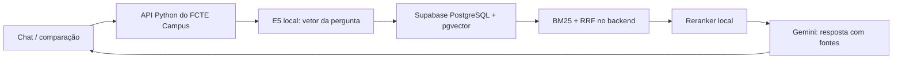

# Migrar o banco vetorial do FCTE Campus para o Supabase

Este tutorial envia os **41 documentos representados por 214 chunks e seus vetores E5 de 384 dimensões**, conforme a base local conferida em 16/11/2026. Não envia imagens, chaves Gemini, conversas ou arquivos privados. O número pode mudar quando o corpus for atualizado; a simulação mostra a quantidade real.

**Estado da integração:** código preparado, migração simulada e SQL executado em PostgreSQL/pgvector local com os 174 chunks. Foram conferidos repetição do envio, autoconsultas, filtros, preservação de versões, rollback de publicações inválidas e bloqueio de acesso público. Nenhum projeto Supabase foi criado ou alterado nesta preparação. A validação da Data API no seu Supabase acontece nos passos 6 e 7.

## 1. O que muda no sistema



O Supabase armazena o texto, o vetor e os metadados de cada chunk, além do manifesto da base. É **PostgreSQL com a extensão pgvector**, não um servidor Chroma hospedado. Não precisa criar bucket: os vetores são registros de banco, não arquivos de Storage.

A migração preserva modelo/revisão E5, prefixos, normalização, IDs, versões, datas, hash das fontes e assinatura da base. BM25, RRF, reranker, Gemini e os endpoints `/api/v1/chat` e `/perguntar` continuam com suas responsabilidades atuais. A busca vetorial remota usa cosseno exato; pequenas diferenças numéricas e desempates em relação ao Chroma ainda devem ser conferidos na avaliação.

**Mover o banco não hospeda os modelos:** E5 e reranker continuam na máquina que executa a API. Os registros de consultas e o histórico usado nas perguntas de continuação continuam em `backend/data/execucoes/`. Esta etapa não resolve o consumo de memória nem a persistência desses registros em um futuro Render gratuito.

**Perfil de deploy leve:** o Docker agora usa `RAG_PROFILE=light`, com leitura dos textos/metadados
do Supabase e recuperação BM25, sem carregar E5 ou reranker. O perfil `full` preserva a busca vetorial
descrita acima. Não é necessário executar o SQL ou migrar novamente para trocar o perfil.
Com light, `rag:check` confere os textos/IDs e uma busca lexical; a verificação dos vetores continua no perfil full.

## 2. Criar ou escolher o projeto

1. Entre em [supabase.com/dashboard](https://supabase.com/dashboard).
2. Use um projeto existente ou crie um projeto gratuito, escolhendo uma região próxima à futura API.
3. Aguarde o banco ficar disponível.

É possível usar o mesmo projeto da coleta: os objetos deste tutorial têm prefixo `fcte_rag_` e não alteram tabelas ou buckets existentes. Antes de escolher o plano, confira as [cotas atuais](https://supabase.com/pricing). Não é necessário contratar disco do Render para guardar este índice.

## 3. Criar a estrutura no SQL Editor

1. No painel do projeto, abra **SQL Editor → New query**.
2. Abra o arquivo [setup.sql](setup.sql) deste diretório no VS Code.
3. Copie **todo** o conteúdo para o editor SQL do painel e clique em **Run**.
4. Aguarde a confirmação de sucesso.

O SQL cria:

| Objeto | Finalidade |
|---|---|
| `public.fcte_rag_colecoes` | Manifesto por versão e indicação da base ativa. |
| `public.fcte_rag_chunks` | Texto, metadados e coluna `embedding vector(384)`. |
| `public.fcte_rag_publicar` | Publica todos os chunks e o manifesto em uma transação. |
| `public.fcte_rag_buscar` | Recupera por distância cosseno e aplica aprovação, abrangência e validade. |

As tabelas usam RLS e não oferecem acesso a `anon` ou `authenticated`. As funções e o acesso aos dados são restritos à `service_role`, utilizada pelo backend com a chave secreta. Não cole chaves no SQL.

Para o tamanho atual, fazemos busca exata e não criamos índice HNSW/IVFFlat. O protótipo aceita até **1.000 chunks por coleção**, compatível com a quantidade atual e o limite padrão de respostas da Data API. Antes de ultrapassar isso, ampliar a paginação da consulta e reavaliar o ranking lexical.

O SQL pressupõe a extensão `vector` no schema `extensions`, padrão comum do Supabase. Se houver erro de tipo inexistente, confira onde a extensão está instalada:

```sql
select e.extname, n.nspname as schema
from pg_extension e join pg_namespace n on n.oid = e.extnamespace
where e.extname = 'vector';
```

Se aparecer outro schema, não mova a extensão de um banco compartilhado sem conferir seus usos. Adapte as referências `extensions.vector` e `operator(extensions.<=>)` do SQL ao schema retornado.

## 4. Configurar a conexão somente no backend

No painel, obtenha a **Project URL** e uma **secret key**. A URL tem formato `https://SEU-PROJETO.supabase.co`; procure no diálogo **Connect** ou nas configurações **Data API**. As chaves ficam em **Settings → API Keys**. Os nomes do menu podem variar.

Prefira a chave `sb_secret_...`; a chave legada `service_role` também funciona. Não use `sb_publishable_...`, `anon`, URL do dashboard, conexão `postgresql://` ou URL de um bucket.

Abra **`fcte-campus/backend/.env`** e acrescente, preservando a chave Gemini já existente:

```dotenv
# Durante a migração, o app continua usando seu Chroma local.
RAG_INDEX_BACKEND=chroma
SUPABASE_URL=https://SEU-PROJETO.supabase.co
SUPABASE_SECRET_KEY=SUA_CHAVE_SECRETA
```

O arquivo já está ignorado pelo Git. As variáveis não devem ter prefixo `VITE_`. Não coloque esses valores no `.env` do frontend ou em capturas de tela. Variáveis exportadas no terminal/provedor têm prioridade sobre `backend/.env`.

## 5. Conferir o envio antes de executá-lo

Todos os comandos npm abaixo são executados na **raiz de `fcte-campus`**, onde está `package.json`. Use o ambiente Python e as dependências já preparados conforme o [README principal](../../README.md). Não há nova dependência Python nesta integração: ela usa o `httpx` existente.

Windows / PowerShell:

```powershell
cd C:\Users\Pedro\OneDrive\Desktop\Challenge3\fcte-campus
npm.cmd run rag:migrate
```

Mac:

```bash
cd /caminho/para/FCTE-Campus
npm run rag:migrate
```

Esse comando **não acessa o Supabase**, não chama o Gemini e não gera embeddings. Ele confere manifesto, hashes, IDs, ordem, dimensão e normalização dos vetores locais. Para a base atual, espere:

```json
{
  "modo": "simulacao_sem_rede",
  "fontes": 41,
  "chunks": 214,
  "dimensao": 384,
  "colecao": "fcte-a0d5e722cd0cf092bea5",
  "assinatura": "a0d5e722cd0cf092bea51f0cd09a8c38f3a702773e49b4c52b1c004d2cff7f99",
  "chroma_local_preservado": true
}
```

Se informar ausência do manifesto/cache/Chroma, você está em um computador que ainda não tem a base local preparada. Mantendo `RAG_INDEX_BACKEND=chroma`, siga `rag:prepare`, `rag:index` e `rag:check` do README principal e depois repita a simulação. Não copie uma `.venv` de outro sistema operacional.

## 6. Enviar os vetores existentes

Com o SQL executado e o `.env` preenchido:

```powershell
# Windows
npm.cmd run rag:migrate -- --enviar
```

```bash
# Mac
npm run rag:migrate -- --enviar
```

Esse é o passo que **escreve no seu Supabase**. O script usa os vetores já existentes no cache validado; não depende de API de embeddings ou Gemini.

Espere `"modo": "enviado_e_conferido"`. O comando compara IDs, contagem e assinatura após a publicação. A transação grava a coleção completa e troca a base ativa juntas. Repetir o envio do mesmo snapshot substitui somente essa versão, sem duplicar registros; outras versões continuam preservadas. Não há exclusão do Chroma local.

Se a conexão cair durante o envio, não assuma que o banco ficou vazio ou incompleto: a transação pode ter sido confirmada. Repetir o mesmo comando é permitido e faz a conferência novamente.

## 7. Conferir o banco remoto e ativar no chat

No SQL Editor, confira:

```sql
select colecao, colecao_logica, ativa,
       manifesto->'indice'->>'total' as chunks_declarados,
       manifesto->>'assinatura' as assinatura
from public.fcte_rag_colecoes;

select colecao, count(*) as chunks,
       count(distinct metadados->>'source_id') as fontes,
       min(extensions.vector_dims(embedding)) as dimensao_minima,
       max(extensions.vector_dims(embedding)) as dimensao_maxima
from public.fcte_rag_chunks
group by colecao;
```

Para a base atual: coleção ativa, **174 chunks, 37 fontes e dimensões 384/384**.

Agora altere **somente** esta linha no `backend/.env`:

```dotenv
RAG_INDEX_BACKEND=supabase
```

Feche o servidor anterior com **Ctrl+C**. Antes de reiniciar, execute:

```powershell
# Windows
npm.cmd run rag:check
npm.cmd run dev:rag
```

```bash
# Mac
npm run rag:check
npm run dev:rag
```

O `rag:check` lê os vetores do Supabase, valida dimensão e normalização e faz uma autoconsulta por cosseno em outro processo. Não refaz ingestão e não depende do arquivo Chroma nem do cache local de vetores. Espere `"armazenamento": "supabase"`, `"reaberto_sem_ingestao": true` e `"autoconsulta_confirmada": true`.

Abra [http://127.0.0.1:8001/api/v1/health](http://127.0.0.1:8001/api/v1/health). Espere os campos:

```json
{
  "status": "ready",
  "sources": 41,
  "chunks": 214,
  "vectorStore": "supabase"
}
```

Se usa a interface pelo Vite, inicie `npm.cmd run dev` no Windows ou `npm run dev` no Mac em outro terminal e abra http://127.0.0.1:5173. Se já tem `dist/` compilado, a API também serve a interface em http://127.0.0.1:8001.

No chat, confira perguntas como:

- “Na biblioteca do Gama há lugar para estudar sozinho e em grupo?”
- “Em qual prédio, andar e sala fica o laboratório COSMOS?”
- “A sala I10 está livre agora?” — a ausência de ocupação atual deve continuar explícita.

O `health` verifica que o índice está acessível e que a chave Gemini foi carregada; a validade/cota Gemini só é conferida em uma geração real. Publicar o índice não equivale a medir novamente todas as métricas de resposta. Antes de atualizar resultados do Pages, execute uma nova rodada e registre a mudança de armazenamento.

O iniciador `iniciar.command` também respeita o armazenamento escolhido. No modo Supabase, confere o banco remoto sem publicar dados automaticamente. A preparação dos modelos locais continua necessária.

## 8. Atualizações futuras e volta ao Chroma

**Novos documentos:** depois de executar a curadoria/chunking do pipeline existente, `npm run rag:index` gera/reutiliza os vetores e publica no armazenamento selecionado. Com `RAG_INDEX_BACKEND=supabase`, esse comando escreve no Supabase. A nova assinatura cria outra versão, mantendo versões anteriores. Os arquivos de catálogo/chunks do app precisam corresponder ao manifesto remoto: atualize também o código nos computadores/servidores que consultam a base.

**Voltar ao banco local:** mude `RAG_INDEX_BACKEND=chroma` e reinicie a API. A migração não altera `backend/data/index/manifesto.json` nem a coleção Chroma original. Se você já atualizou os documentos depois da migração, execute `rag:index` no modo Chroma antes de iniciar.

Não apague o índice local durante a primeira validação. Ele não precisa ir para o GitHub nem para a hospedagem que usar somente Supabase.

## 9. Diagnóstico

**Atualizações sem interromper o deploy anterior:** após gerar chunks e indexar no Chroma local, execute `npm.cmd run rag:migrate -- --preparar` pela raiz. Esse modo envia um snapshot inativo e publica seu manifesto somente após conferir a coleção; não muda a versão ativa. A API atual seleciona o snapshot compatível com os hashes dos seus arquivos versionados, permitindo versões antiga e nova coexistirem durante o deploy. Envie também o catálogo e os chunks no commit. O `--enviar` continua ativando a nova coleção globalmente, como na migração inicial.

| Sintoma | O que conferir |
|---|---|
| `SUPABASE_URL` inválida | Use somente a URL HTTPS do projeto, sem `/rest/v1`, `/dashboard` ou barra de bucket. |
| HTTP 401/403 | Secret key correta no backend; não usar publishable/anon. Confirme permissões do SQL. |
| HTTP 404 / função não encontrada | Execute o SQL completo no projeto correto e aguarde o cache da Data API atualizar. |
| HTTP 400 | Confira o SQL, a coluna `vector(384)` e se está usando vetores E5 compatíveis. |
| Nenhuma base ativa | Execute `rag:migrate -- --enviar` antes de ativar o modo Supabase. |
| Catálogo/chunks incompatíveis | O código local e a base remota devem pertencer à mesma versão do corpus. |
| Conexão indisponível | Confira internet, URL e se o projeto Supabase está pausado. |
| Ainda aparece `vectorStore: chroma` | Reinicie a API e confira se uma variável exportada no terminal está sobrescrevendo o `.env`. |
| Demora ou falta de memória | E5 e reranker continuam locais; hospedar o vetor não elimina o custo dos modelos. |

## Referências

- [Supabase: colunas vetoriais](https://supabase.com/docs/guides/ai/vector-columns).
- [Supabase: busca semântica e distância cosseno](https://supabase.com/docs/guides/ai/semantic-search).
- [Supabase: funções de banco e permissões](https://supabase.com/docs/guides/database/functions).
- [Supabase: chaves secretas e service_role](https://supabase.com/docs/guides/getting-started/api-keys).
- [Supabase: planos e limites](https://supabase.com/pricing).
