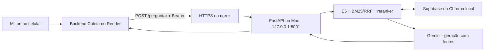

# RAG no MacBook, integrado ao Coleta por ngrok

## Plano e arquitetura

O Coleta continua no Render. O pipeline completo do Grupo 09 roda no MacBook: E5, busca híbrida BM25/RRF e reranker. A geração continua usando a API Gemini. O banco pode continuar no Supabase já configurado, ou ser o Chroma local do Mac. Não é preciso migrar os vetores para trocar a hospedagem da API.



- **Coleta:** mantém o orquestrador, histórico, integração do RUmo, mapa e rotas. URL e token do RAG ficam no backend do Render. O navegador não recebe essas credenciais.
- **Mac:** mantém o RAG e a chave Gemini. A API escuta apenas em `127.0.0.1`; o ngrok faz a conexão de saída, sem abrir portas no roteador.
- **Contrato:** continua `POST /perguntar`, com pergunta, contexto e limite de trechos; retorna resposta, fontes, versão da base e identificador da execução. Não muda o contrato para o RUmo.
- **Rotas e proximidade:** continuam usando o inventário atual do mapa e o motor no navegador. GPS não precisa passar pelo túnel para responder onde fica o banheiro mais próximo.

O domínio de desenvolvimento do ngrok gratuito pertence à conta e permanece igual ao reiniciar o agente. Os limites publicados em 18/11/2026 são **20.000 requisições HTTP/mês e 1 GB de transferência de saída/mês**. APIs programáticas não precisam da página intermediária do navegador; o cliente da coleta envia também `ngrok-skip-browser-warning: 1`.

Fontes: [domínios ngrok](https://ngrok.com/docs/gateway/domains), [limites do plano gratuito](https://ngrok.com/docs/pricing-limits/free-plan-limits), [instalação no macOS](https://ngrok.com/download/mac-os).

## 1. Preparar o projeto no Mac

Os arquivos desta implementação precisam estar na cópia do Mac. Use `git pull --ff-only` **depois** que o commit/push dessas alterações for autorizado e enviado. Não descarte modificações locais para atualizar.

Dentro da pasta `FCTE-Campus`, execute no Terminal nativo do Mac com chip Apple:

```bash
brew install python@3.12 ngrok
python3.12 -m venv backend/.venv
./backend/.venv/bin/python -m pip install --upgrade pip
./backend/.venv/bin/python -m pip install -r backend/requirements.txt
./backend/.venv/bin/python -m pip check
```

Se a `.venv` já foi criada neste Mac e está atualizada, reutilize-a. Não copie a `.venv` do Windows. Este modo de API usa Python e ngrok; não exige compilar a interface.

Se ainda não existe `backend/.env`:

```bash
cp backend/.env.example backend/.env
```

Edite `backend/.env` com a chave Gemini. Para reutilizar o banco que já está no Supabase, preserve as credenciais desse banco:

```dotenv
GEMINI_API_KEY=SUA_CHAVE
GEMINI_MODEL=gemini-3.5-flash-lite
RAG_INDEX_BACKEND=supabase
SUPABASE_URL=https://SEU-PROJETO.supabase.co
SUPABASE_SECRET_KEY=SUA_CHAVE_SECRETA
```

Também é possível usar `RAG_INDEX_BACKEND=chroma`; nesse caso os vetores ficam no Mac e serão reconstruídos localmente na preparação. O iniciador não publica nem altera coleções do Supabase. Ele força `RAG_PROFILE=full` na configuração separada do túnel, mesmo que o `.env` usado no deploy antigo esteja como `light`.

## 2. Criar a conta ngrok

1. Crie uma conta gratuita em [ngrok](https://dashboard.ngrok.com/signup).
2. Abra **Getting Started → Your Authtoken**.
3. Configure o agente no Mac usando o comando indicado no painel:

```bash
ngrok config add-authtoken SEU_AUTHTOKEN_NGROK
ngrok config check
```

Esse authtoken autentica o agente no ngrok. Ele é diferente do token do RAG que a coleta usará.

Em **Domains**, copie a URL do **dev domain** atribuído à conta, por exemplo `https://nome-atribuido.ngrok-free.app`. Use a URL que o seu painel mostrar; não crie um domínio personalizado pago.

## 3. Preparar e iniciar

Na raiz do `FCTE-Campus`, substitua a URL pelo endereço da sua conta:

```bash
bash servir-ngrok.command --url https://nome-atribuido.ngrok-free.app --preparar
```

A primeira execução baixa/prepara E5 e reranker. Com Chroma, reconstrói o índice local; com Supabase, apenas confere a coleção existente. Depois:

1. Cria `backend/.env.ngrok`, privado, sem modificar `backend/.env`.
2. Gera ou reutiliza um token de integração de pelo menos 32 caracteres.
3. Inicia a API completa em `127.0.0.1:8001` e aguarda o RAG ficar pronto.
4. Confere localmente o bloqueio sem token e o contrato autenticado, sem gerar resposta Gemini.
5. Abre o ngrok apontando para a API e desliga a inspeção de corpos HTTP no agente.
6. Mantém o Mac acordado por ociosidade enquanto o comando estiver aberto.

No modo `RAG_API_ONLY=true`, apenas `/perguntar`, `/api/v1/multiagent` e `/api/v1/health` ficam acessíveis. As duas consultas exigem Bearer. O chat web, comparações e documentação interativa não ficam expostos por esse modo. O iniciador local normal `iniciar.command` permanece disponível para o chat independente.

O contrato usado pelo Coleta em `/perguntar` mantém o RAG atual. O fluxo Pesquisador → Redator → Revisor está disponível em `POST /api/v1/multiagent`, com o mesmo Bearer e corpo `{"text":"Sua pergunta","campus":"gama"}`. Ele pode usar até cinco chamadas Gemini e não troca automaticamente o modo utilizado pelo Coleta.

Também cria **`backend/.env.coleta-ngrok`**, com exatamente as três variáveis para o backend do Coleta:

```dotenv
G09_API_URL=https://nome-atribuido.ngrok-free.app
G09_API_TOKEN=TOKEN_GERADO_LOCALMENTE
G09_TIMEOUT_SECONDS=120
```

Esses dois arquivos são ignorados pelo Git e recebem permissão de leitura/escrita apenas para o usuário no Mac. Não envie seus conteúdos no chat nem os coloque no frontend.

Após a criação, alterações da chave Gemini ou das credenciais do banco desse modo devem ser feitas em `backend/.env.ngrok`. O token é preservado ao reiniciar; se você o trocar, atualize também `G09_API_TOKEN` no Render.

Se quiser gerar somente os arquivos privados antes de iniciar:

```bash
bash servir-ngrok.command --url https://nome-atribuido.ngrok-free.app --configurar
```

Nas próximas vezes, reutilize a configuração e os modelos:

```bash
bash servir-ngrok.command
```

Deixe o terminal aberto e a tampa do Mac aberta. `Control + C` encerra somente a API e o túnel iniciados por esse comando. Fechar a tampa, desligar ou perder internet interrompe o atendimento. O iniciador recusa uma porta ocupada; não encerra outros servidores.

## 4. Apontar o Render da coleta para o Mac

Primeiro confirme que o ngrok registrou a conexão. No navegador, o health pode exibir a página de confirmação do ngrok; via terminal:

```bash
curl --fail --silent --show-error \
  -H 'ngrok-skip-browser-warning: 1' \
  https://nome-atribuido.ngrok-free.app/api/v1/health
```

Confira `status: ready`, `retrievalProfile: full`, `vectorSearchEnabled: true` e `rerankerEnabled: true`.

No painel do Render:

1. Abra o serviço **coleta-fcte** → **Environment**.
2. Atualize `G09_API_URL`, `G09_API_TOKEN` e `G09_TIMEOUT_SECONDS` com os valores do arquivo privado `backend/.env.coleta-ngrok` do Mac. Pode usar a importação de `.env` para essas três variáveis.
3. `G09_API_URL` é só o endereço HTTPS base: **não acrescente `/perguntar`**.
4. Salve e reinicie/reimplante o serviço conforme o painel solicitar.

Mantenha as demais variáveis do Coleta e do RUmo. A chave Gemini do RAG continua no Mac; não precisa ser copiada para a coleta. O Render antigo do FCTE-Campus só deve ser desligado depois de conferir o fluxo novo. Para voltar temporariamente, restaure URL e token desse serviço antigo.

## 5. Conferir o fluxo

No projeto da coleta, o diagnóstico lê `.env`/variáveis de ambiente e não usa Gemini por padrão:

```bash
./.venv/bin/python -m scripts.verificar_rag
```

Para conferir com um arquivo privado diferente:

```bash
./.venv/bin/python -m scripts.verificar_rag --env-file /CAMINHO/FCTE-Campus/backend/.env.coleta-ngrok
```

Ele verifica health, recusa sem token e aceitação do token usando um corpo inválido, que retorna HTTP 422 sem gerar resposta. Uma consulta real é opcional e usa a cota Gemini:

```bash
./.venv/bin/python -m scripts.verificar_rag --pergunta 'A biblioteca do Gama tem cabines individuais?'
```

Depois abra o Milton no Coleta publicado e faça a mesma pergunta documental. Confira resposta, fontes e registro da consulta. Uma pergunta de rota/banheiro pode ser atendida pelo mapa local e, portanto, não comprova que a API documental do Mac foi chamada.

## Diagnóstico rápido

| Sintoma | Conferir |
|---|---|
| Porta 8001 ocupada | Encerre sua execução anterior ou use `--port 8002`; o túnel acompanha a porta escolhida. |
| RAG não abre o índice | Rode com `--preparar`; confira a coleção Supabase correspondente aos chunks desta versão. |
| `Invalid host header` | Use o iniciador e a URL exata do painel; ele configura o hostname permitido. |
| HTTP 401/403 | Token em `G09_API_TOKEN` deve ser o mesmo de `RAG_API_TOKEN` em `.env.ngrok`. |
| HTTP 404 em `/api/v1/chat` | Esperado no modo somente integração. O Coleta usa `/perguntar`. |
| Endpoint ngrok offline/HTTP 502 | Confira terminal do ngrok, processo da API, internet e suspensão do Mac. |
| Mudou a URL no ngrok | Reexecute com `--url NOVA_URL` e atualize `G09_API_URL` no Render. |
| Acabou a cota ngrok ou Gemini | Confira o Usage de cada serviço; um não substitui a cota do outro. |

O código pode ser conferido com clientes locais e serviços simulados antes da publicação. O teste completo Mac → ngrok → Render depende do Mac ligado, do dev domain real e da configuração no painel do Render.
